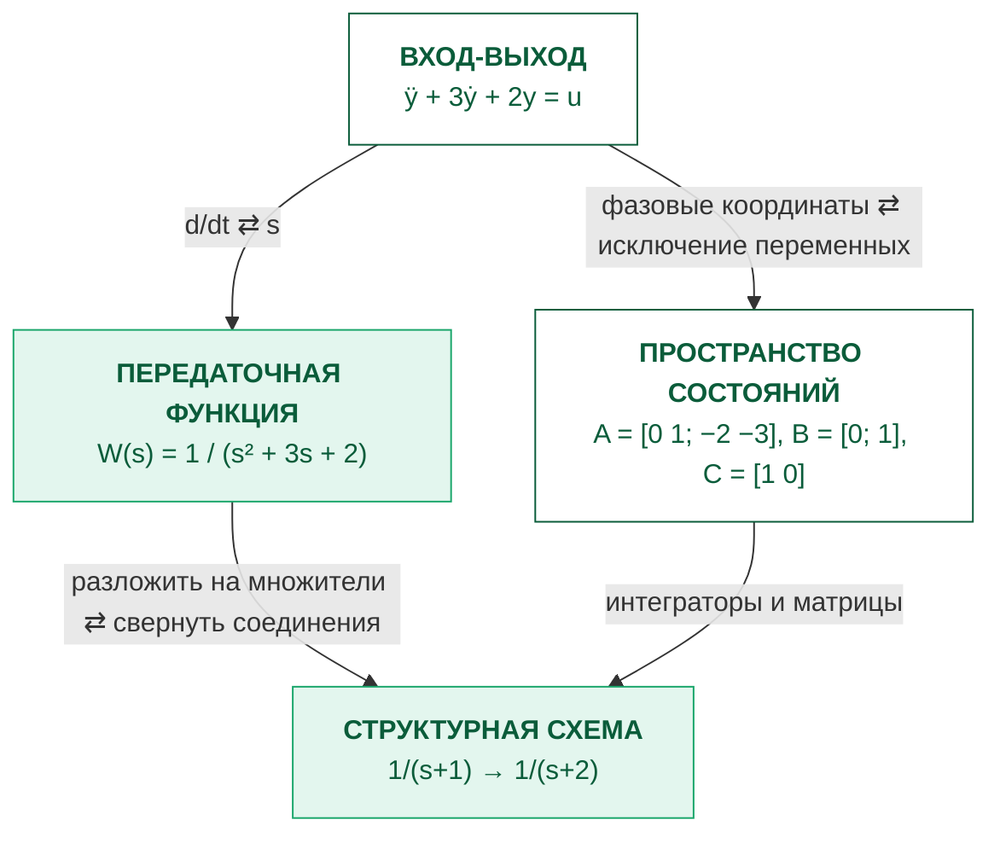

# Преобразование лапласа и теория функций для непрерывных объектов и систем

$$\dot{x}=Ax+Bu$$
$$y=Cx+Du$$
$y$ — вектор выхода.
$С$ — матрица выхода
$D$ — матрица прямой связи

Афинное преобразование — параллельный сдвиг.

u -> W -система -> y

# Преобразование Лапласа

Прямое преобразование Лапласа
$$Y(t)=\int_0^\infty y(t)e^{-st}dt$$
Свойства преобразования Лапласа:
1. Линейность ($L(af+bg)=aF+bG$)
2. Дифференцирование ($L(\dot{y})=sY(s)-y(0)$)
3. Интегрирование
4. Запаздывание

$$\dot{x}=Ax$$
$$sX=AX$$
$$X={A \over s}X$$
1/s — интегрирование.

*Передаточная функция* 

$$By(t) = Au(t)$$
$$B(s)Y(s)=A(s)U(s)$$
$$W(s)={A(s) \over B(s)}$$
$$W(s) = {Y(s) \over U(s)}$$

Передаточная функция — чувствительность выхода ко входу.

Интегрирующее звено:
$$W(s) = {k \over s}$$
$$\dot{y} = ku$$
Дифференцирующее звено:
$$T \dot y + y = k \dot u$$
$$(Ts+1)Y(s)=ksU(s)$$
$${Y(s) \over U(s)}={ks \over Ts+1}$$
$$W(s)={ks \over Ts+1}$$

При последовательном соединении систем передаточные функции перемножаются. При параллельном — складываются.

## Переход по разным формам моделей

| Из ПС сразу в $W$ | Полюсы |
|:---|:---|
| $W(s) = C\,(sI - A)^{-1} B + D$ — одна формула для любой модели в ПС. | $-1$ и $-2$: корни знаменателя $W(s)$, собственные числа $A$, звенья схемы. Во всех формах одни и те же. |

## Пример интерпретации значения переменной в Лапласе:
$$s=-2+5j$$
-2 — затухающие колебания,
5 — период = 5.

Если значение переменной $s = 0$, то установился устоявшийся режим.
